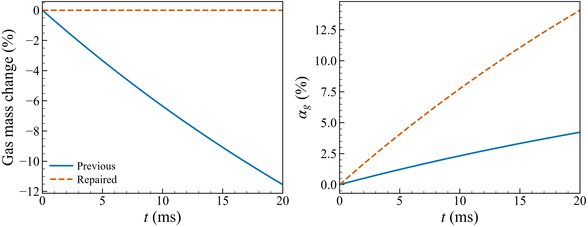
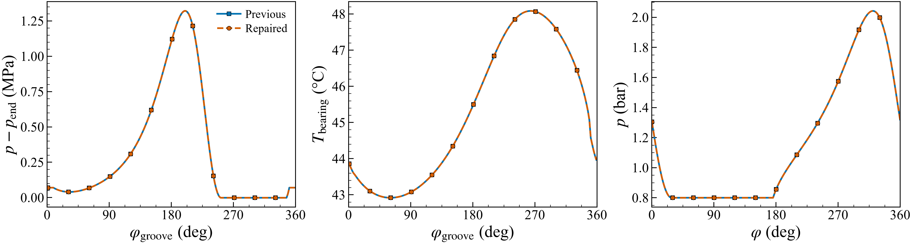
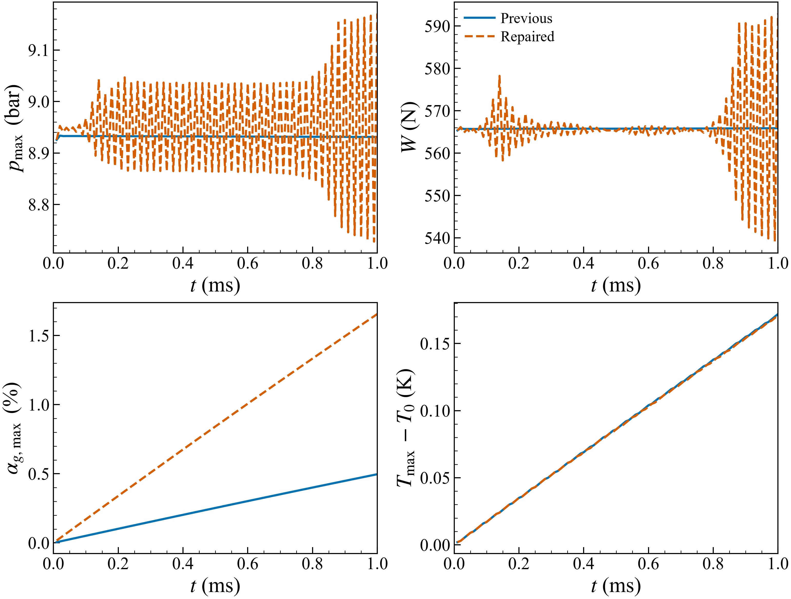
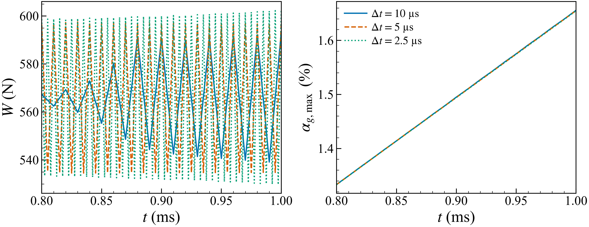
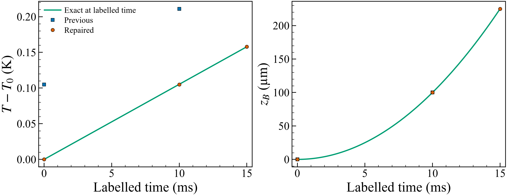

# Effect of the physics repairs

The tested pure-oil bearing curves survive the audit unchanged at VTK output
precision. Gas inventories do not. The old local-release calculation lost gas
and substantially suppressed free-gas volume. The conservation repair removes
that error, but the longer bearing test exposes a separate unstable coupling
between pressure and gas volume. Quantitative gas-coupled transient load
predictions are not ready for experiments.

These are fresh comparisons of `b9dcaf3` and `2bc4d3c`, not comparisons between
different meshes or retuned bearing positions. Ten paired runs and two timestep
refinements were executed locally with MinGW GCC 16.1, PETSc and MS-MPI, one
rank. All inner Reynolds solves converged; both steady thermal iterations
converged. Transients perform one segregated sweep and have no outer coupling
convergence test. The preceding repair passed 40/40 tests on native Windows
and Linux. Those regression passes do not establish physical adequacy.

## What was wrong and what changed

| Problem in the previous implementation | Repair in `2bc4d3c` | Consequence for results |
|---|---|---|
| Time storage did not consistently difference the complete old/new liquid inventory | Store and difference `rho_l h theta`, including density and geometry history | Gap and property changes no longer masquerade as species creation or loss |
| Dissolved transport used a material-equation correction inconsistent with changing liquid mass | Solve conservative dissolved inventory using the FBNS liquid face mass flux | Concentration follows the transported carrier inventory |
| Reaction removed dissolved gas, then relaxed only the free-gas update | Integrate frozen-state exchange analytically and transfer equal mass between phases | Released gas is retained; transient relaxation no longer creates an artificial release delay |
| Release left the original solution mass and used inconsistent concentration denominators | Update liquid mass, dissolved mass fraction and liquid volume together | Base oil and total gas remain invariant in a closed cell |
| Reservoir assignment and diagnostic fluxes did not represent the actual transport solve | Impose composition inside transport solves and preserve their boundary fluxes | Step residuals include the imposed supply and actual transported gas |
| The driver advanced at label zero, overshot the end, and saved fields and motion at different time levels | Save initial state, advance geometry/fields to a shared target time and shorten the final step | Temperature and motion can be compared at their stated physical time |
| Unknown species silently selected propane; dissolved density and table-viscosity paths could disagree | Reject unsupported species/missing partial-volume data and share viscosity conversion | An R410A label cannot produce an undisclosed propane calculation |

Other repairs add nonlinear failure exit codes, steady gas convergence checks,
volume diagnostics and output cleanup that preserves unrelated files. The
[audit](../../../docs/PHYSICS_AUDIT_2026-09.md) and
[PHYSICS.md §18](../../../PHYSICS.md#18-conservative-gas-update-and-experimental-scope-2026-09-06)
give the mechanisms and remaining formulation work.

## Closed release isolates the mass error

This test holds p = 1 bar absolute and T = 313.15 K, with dissolved mass
fraction 0.002, equilibrium fraction 0.001 and transfer rate 20/s. There are
no boundary fluxes. The gas-mass change plotted below includes both dissolved
and free species.

At 20 ms the previous calculation has lost **11.548% of its gas inventory**.
The repaired maximum relative drift is **1.33 × 10⁻¹⁵**. Base oil and total
mixture mass also remain constant to floating-point precision. The repaired
dissolved inventory agrees with the independent frozen-state analytic solution
within 1.1 × 10⁻¹⁹ kg/m².

Free gas occupies 4.226% of the gap in the old calculation and 14.079% in the
repaired one, a factor of 3.33. The old smooth, small void fraction was partly
a numerical mass-loss effect. These numbers verify the implementation of the
chosen kinetic law; the rate and solubility here are synthetic.

## Existing steady bearing results

The first two panels show the archived Ferron smoke iterate at 180 × 48, with
its eccentricity, attitude and groove supply flow held fixed. The third shows
the optical-rig P1 setup at 720 × 192. Both revisions give the following values.

| Quantity | Ferron steady iterate | Optical P1 |
|---|---:|---:|
| Maximum absolute pressure | 1.421960 MPa | 2.04238 bar |
| Pressure-force magnitude, `Fp` | 4000.270 N | 151.432 N |
| Total fluid-force magnitude, `F` | 3985.689 N | 148.917 N |
| Maximum film temperature | 48.355 °C | 20.000 °C |
| Maximum bush surface temperature | 48.084 °C | Not solved |

Pressure, temperature, liquid content and viscosity fields are identical at
saved precision. Residual-field differences are at roundoff. The optical
pressure load, peak pressure and 148° any-axial liquid-deficit arc reproduce
the archived row `r1_e050_n1500_p080`, within its printed rounding.

This supports retaining these specific pure-oil reference curves. It adds no
new experimental accuracy claim. Ferron here is a smoke-grid iterate, not the
G6 thermal-validation comparison; the earlier temperature eligibility issues
remain. Optical P1 prescribes a scalar cavitation plateau and contains no
released gas, so its apparent cavity does not validate gaseous cavitation.

## Flowing oil-air transient and the remaining failure

This 48 × 8 synthetic bearing has finite-rate release, an inlet groove and
film-averaged heating. Old labels are shifted by one 10 µs step, so both curves
cover the same elapsed time. The old extra terminal advance is excluded.

At 1 ms, maximum gas fraction changes from **0.4966% to 1.6558%**. The maximum
temperature rise remains close to 0.172 K; the two maximum-temperature
histories differ by at most 0.001 K at saved precision. Fieldwise temperature
differences reach 0.003 K. More gas changes mixture viscosity and the
liquid-volume ceiling, so pressure and force can change even with almost the
same temperature.

The repaired pressure and load alternate between consecutive steps. Its
terminal total force is 592.95 N versus 565.87 N previously, but this **is not
evidence of a physical 4.8% load increase**. The terminal sample falls on the
high side of an unresolved numerical oscillation.

| Repaired timestep | Terminal maximum gas fraction | Total-force range during the last 0.2 ms | Maximum excess gap volume |
|---|---:|---:|---:|
| 10 µs | 1.65577% | approximately 539–593 N | 0.3358% |
| 5 µs | 1.65525% | 534.50–597.46 N | 0.2988% |
| 2.5 µs | 1.65489% | 529.70–602.36 N | 0.1731% |

Halving the timestep twice does not remove the alternating load. The
frequency follows the timestep and the amplitude grows. Maximum gas fraction
changes little, but its apparent stability does not validate spatial gas
distribution or cavity pressure. The refined histories are archived without
smoothing or step averaging.

Pressure uses a lagged gas-volume ceiling; subsequent transport/reaction
changes gas volume without re-closing pressure and gap occupancy. That missing
coupling is consistent with the observed timestep-linked instability. The
test does not uniquely isolate every feedback term. A small Newton residual
only certifies the frozen pressure subproblem.

The repaired gas step residual is below 1.4 × 10⁻¹² in the 10 µs run, yet
volume excess reaches 3.36 × 10⁻³ of the gap. Both diagnostics are necessary.
The old residual is not an equivalent independent estimator because its
boundary accounting also changed; the closed probe above establishes the mass
error directly.

These runs must not be used to fit release time constants from load histories
or to claim a physical pressure oscillation. Pressure, species inventories,
gas EOS and gap volume need a converged coupled solve. Restoring the old
mass-losing relaxation would conceal the failure again.

## Correct physical time

For a requested duration of 15 ms with a nominal 10 ms step, the old driver
saved at labels 0 and 10 ms but advanced the fluid for 20 ms. It reported a
0.211 K final temperature rise. The repaired driver saves at 0, 10 and 15 ms,
with a 0.158 K final rise, matching the exact 0.157895 K. The old run integrated
33.3% too much heating relative to the requested duration. This is a timing
error, not a change in heat-transfer physics.

The decoupled axial position at 15 ms is now 225 µm, matching `z = t²` for the
prescribed force and mass. The previous final saved motion state stopped at
the 10 ms position, 100 µm. Symbols are saved states; the green curves are the
analytic solutions. General fluid-driven motion still uses the previous fluid
force and requires its own coupled timestep study.

## What this means for the experimental goal

Keep FBNS as the verified equilibrium Reynolds baseline. The repairs establish
consistent inventories and elapsed time, but a fast calculation with the
present gas closure is not yet an accurate oil-air transient simulation.
Resolve the pressure/species/volume coupling before calibrating it.

Oil-R410A remains unsupported. It needs oil-specific R32/R125 solubility,
composition-dependent liquid properties and a gas-mixture EOS. The solver also
has no independent transported vapor inventory or latent/dissolution heat
closure. This comparison therefore supplies no validated oil-R410A curve and
does not establish simultaneous vaporous and gaseous cavitation capability.

Observed single-run times were 10.99 → 11.04 s for Ferron, 31.22 → 28.26 s for
optical P1, and 1.69 → 2.32 s for the air case. They include output and are not
repeated performance measurements; the air runs also differ by one advance.
No speedup claim is supported. Solver and input hashes, histories and reduction
checks are in [the evidence](evidence/summary.json), with reproduction in
[README.md](README.md).
