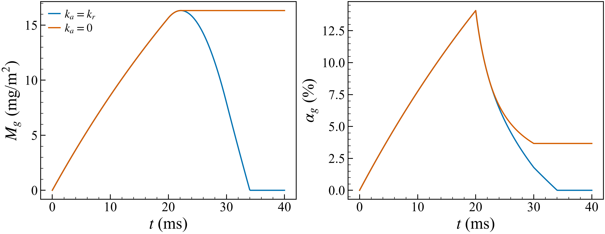
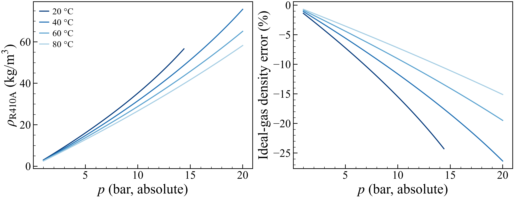
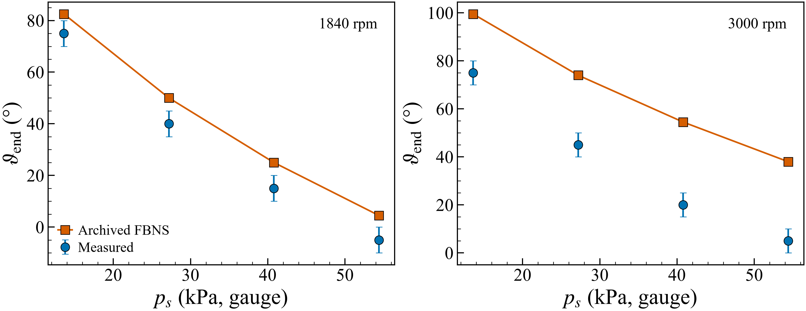

# FW68D journal bearings: physics, corrections, and remaining gaps

2026-09-07. This extends the [branch/history audit](PHYSICS_AUDIT_2026-09.md)
and [paired solver comparison](../cases/90_diagnostics/physics_comparison/SUMMARY.md).
Those contain the accessible branch inventory, commit provenance, old test
campaigns, and reproducible before/after results. No remote branches were fetched.
The dirty Ferron checkout was preserved; repairs are in the separate audit checkout.

**The current code is not yet a validated FW68D–air or FW68D–R410A cavitation
solver.** Its verified equilibrium Reynolds baseline and repaired species
inventories are useful, but the transient pressure/volume closure still fails
a timestep check. R410A is still rejected by the bearing solver. The R410A EOS
calculations below are an independent material diagnostic, not a new solver backend.

## 1. The experiment being modeled

The specified oil is **FW68D**, the temperature range is **20–80 °C**, and inlet
and outlet reservoir pressures can reach **20 bar**. The R410A charge is to be
saturated near **10 bar**. Pressures here are absolute, consistent with the
clarification question; saturation temperature has not yet been supplied.
Oil–air remains a separate required experiment and model branch.

FW68D is identified as PVE in [LG's equipment specification](https://www.lg.com/uk/business/hvac/commercial-solutions/vrf-system/multi-v-s/arun120lss0/).
That identifies the lubricant family, not its solubility curve. Neither the
existing R290/PZ68S data nor literature R410A/FVS50 data establishes FW68D
properties. FVC68D must not be assumed to be the same product as FW68D.

The charge inventory is a preparation condition:

\[
c_{r,0}=c_{r,\mathrm{eq}}(p_{\mathrm{charge}},T_{\mathrm{charge}}).
\]

Once charged, heating the oil or dropping its pressure changes its equilibrium
concentration. It does not reset the actual total refrigerant inventory at
every cell. A 10-bar charge pressure is therefore neither a universal cavity
pressure nor a lower limit on the bearing's pressure field.

## 2. Boundary conditions, including reverse flow

Both axial ends connect to pressure reservoirs. At each end impose
\(p=p_{\mathrm{reservoir}}\); the film solution determines the sign of the flux.
Different circumferential portions of the same end can admit and discharge
fluid simultaneously. No one-way valve is implied by the word “outlet.”

For a boundary mass flux \(F_n\), positive outwards, an advected quantity obeys

\[
(F_n\phi)_b=\max(F_n,0)\phi_{\mathrm{interior}}
             +\min(F_n,0)\phi_{\mathrm{reservoir}}.
\]

The existing `DIRICHLET` pressure boundaries already permit either flow
direction. The legacy `INLET_OUTLET` option is a different switching pressure
condition; it is not needed to obtain reverse flow and is not supported by FBNS.
`NEUMANN` closes the axial pressure flux in the current implementation.

Previously both ends used the same global dissolved concentration and, when
reservoir thermal inflow was enabled, the same reference temperature. Free-gas
inflow was always zero. That cannot describe two distinct reservoirs or entrained
bubbles returning through an outlet. The code now accepts, independently at
each end:

| Setting suffix after `bc_z_south_` or `bc_z_north_` | Meaning |
|---|---|
| `val` | Reservoir pressure, Pa absolute |
| `thermal = CONSTANT` | Use reservoir temperature on inflow |
| `temperature` | Reservoir K; 0 inherits `temperature_reference` |
| `dissolved_gas` | Dissolved species / liquid-solution mass; −1 inherits initial concentration |
| `free_gas_mass_fraction` | Free species / total incoming mixture mass; default 0 |

The incoming free-gas mass flux is \(F_l q/(1-q)\), where \(F_l\) is incoming
liquid-solution mass flux and \(q\) is the configured free-gas mass fraction.
This assumes a common transport velocity; it does not resolve phase slip.
Outgoing species fluxes use the solved interior state. The diagnostic records
the flux actually applied by the transport equation.

These species boundary states are consumed by the transient `TWO_PHASE`
transport path. The existing steady local feed-flash path does not solve
conservative species transport and cannot establish a steady solution with
different reservoir compositions. Thermal boundary states are used by the
energy-equation path; an isothermal calculation does not solve for temperature.

For thermal `ZERO_GRADIENT`, inflow extrapolates the interior temperature. This
can approximate thermal recirculation, but it does not represent an independently
specified reservoir. An explicit end temperature paired with this mode is now
rejected instead of ignored. The historical default is retained for compatibility;
new reservoir-fed thermal cases should explicitly select `CONSTANT`.

Three supply geometries are already represented:

* **No internal inlet:** omit inlet entries; supply and discharge occur through
  the axial ends.
* **Groove:** an angular strip of prescribed pressure spanning the axial length.
* **Hole:** a circular prescribed-pressure patch, localized in both the
  circumferential arc coordinate and the axial coordinate.

These are internal reservoir patches in a surface model. They do not resolve
the groove depth, hole passage, entrance loss, or a supply jet. The current
internal gas patch uses the global initial composition and zero free gas, and
resets its gas state; it is not a general bidirectional species-flux boundary
for several independently characterized internal reservoirs. Fresh-oil thermal
mixing is a separately selected inlet model. This remaining distinction matters
if the hole itself reverses flow, even though axial reverse flow is now tested.

### A hidden pressure substitution

`LOCAL_PSAT` is named misleadingly: `effective_p_cav()` uses the **initial**
concentration and temperature to calculate one global bubble-point floor.
The axial pressure helper then takes the maximum of the requested boundary
pressure and this floor. Validation previously compared against only `p_cav`,
so the effective floor could silently replace a requested reservoir pressure.

Example: a 10-bar bubble-point floor and a 1-bar outlet could be solved with an
effective 10-bar outlet. This suppresses the very depressurization intended to
cause outgassing. Validation now rejects axial and internal reservoir pressures
below the effective floor. The error identifies the model conflict. It is not
resolved by increasing the experimental outlet pressure or treating the charge
pressure as oil vapor pressure. A coupled gas EOS must permit pressure below the
charge bubble point while conserving the released gas.

## 3. What was wrong with the inventories

Let the liquid solution consist of oil plus dissolved species, and define
inventories per unit bearing surface area:

\[
M_l=\rho_l h\theta,\quad M_d=c_dM_l,\quad M_o=(1-c_d)M_l,\quad M_g=\text{free-species mass}.
\]

**Storage previously used the wrong carrier state.** Concentration is not
conserved by itself. If the gap, liquid filling fraction or density changes,
using current capacity to multiply an old concentration creates or destroys
species. The repaired time derivative uses the actual saved
\((\rho_l h\theta c_d)^n\). The Reynolds liquid storage similarly uses old
density and gap. FBNS dissolved transport now uses the same face carrier mass
flux as the pressure equation, rather than a separately reconstructed flux.

**Gas release changes liquid-solution mass.** Moving mass \(\Delta M\) from
dissolved to free species requires

\[
M_l'=M_l-\Delta M,\qquad M_d'=M_d-\Delta M,\qquad M_g'=M_g+\Delta M,
\qquad c_d'=\frac{M_d'}{M_l'}.
\]

Subtracting from concentration while holding its liquid-mass denominator fixed
does not satisfy these identities. The corrected reaction updates all three
inventories together and reconstructs density and film content. Oil mass and
total species mass then remain invariant during local exchange.

**The old relaxation destroyed mass.** Free gas was numerically relaxed after
the corresponding dissolved species had already been removed. Relaxing only
one side of an exchange is an artificial species sink, not a slower physical
kinetic law. The physical time update now integrates the source analytically
and applies equal and opposite transfers. The old closed test lost **11.548%**
of its gas in 20 ms; the repaired test conserves it to roundoff. Its free-gas
volume fraction changes from **4.226% to 14.079%** at 20 ms. A smooth old
void-fraction curve was therefore not evidence that its physics was better.

This is a prescribed-pressure local reaction check, not a sealed rigid-volume
bearing calculation. It isolates inventory errors from the pressure closure.

**Dissolved molecules do not occupy their free-gas volume.** The previous
fallback used gas EOS density as the density of dissolved material when its
partial liquid volume was unspecified. At a few kg/m³ versus an oil density
near 10³ kg/m³, this can invent a large liquid-volume change before any bubble
has formed. The mixture density law now requires an explicit partial-volume
property instead of using that fallback. It still needs oil-specific data.

**Saturated property tables have limited scope.** Converting kinematic
viscosity to dynamic viscosity now uses one shared helper, \(\mu=\rho_l\nu\),
including the cross-film thermal path. However, a saturated \((p,T)\) table
contains composition implicitly. It cannot independently specify
\(\mu(p,T,c_d)\) during finite-rate release or absorption. That constitutive
gap remains; the unit conversion repair does not fill it.

## 4. Compression is different from absorption

For ideal air at fixed temperature, \(V_g=M_gR_aT/p_a\). Increasing pressure
reduces the bubble volume even if no air dissolves. An absorption law that
removes gas whenever bubbles shrink confounds two different processes.

The previous code forced equal release and absorption rates. It now has
`gas_absorption_rate`: −1 retains the legacy equal-rate assumption, zero
disables absorption, and a positive value specifies its own rate in s⁻¹.
`gas_mass_transfer_rate` remains the release rate. Both directions retain the
same conservative analytical integration. No universal FW68D rate is assigned.

The following controlled calculation holds pressure at 1 bar for 20 ms, raises
it to 4 bar over 10 ms, and holds it there. Release is 20 s⁻¹ in both curves;
absorption is either 20 s⁻¹ or zero. These are illustrative values.

With equal rates the free gas vanishes by the end. With zero absorption,
16.324 mg/m² remains while its volume contracts. Both conserve oil and total
air to relative errors below 1.4×10⁻¹⁵. A separate regression test verifies
exactly quartered gas volume after a fourfold pressure increase, and checks
absorption-only kinetics against its analytical solution.

High-speed narrow-gap experiments distinguish early gas release from later
expansion and compression, with little measurable reabsorption over their short
event. This supports separating the mechanisms, but their paraffin results do
not set FW68D rates (Reinke et al., *[Fluids](https://doi.org/10.3390/fluids7050159)*, 2022,
§§4.2–4.3, Figs. 16–19).

## 5. Why the repaired gas-bearing plots are still not predictions

The pressure solve uses a lagged gas volume fraction to set
\(\theta_{\mathrm{full}}=1-\alpha_g\). The subsequent transport/reaction step
changes gas mass, liquid mass and gas volume. Pressure is not simultaneously
re-solved to satisfy the new phase state.

An acceptable final state must close both the mass balances and the occupied
volume. For separate liquid, noncondensable gas and vapor inventories, a
schematic volume constraint is

\[
\frac{M_l}{\rho_l}+\frac{M_a}{\rho_a}+\frac{M_v}{\rho_v}=h.
\]

When gas and vapor share a phase, its mixture EOS replaces the separate-volume
form; each chemical component must still have its own conserved inventory.
Clipping a plotted volume fraction to \([0,1]\) does not repair excess stored
mass or make this constraint true.

The repaired 1-ms synthetic air bearing conserves species, but load alternates
between successive timesteps. Halving the timestep twice does not remove it:

| Timestep | Load range over the final 0.8–1.0 ms | Final maximum gas fraction |
|---|---:|---:|
| 10 µs | 539.1–593.0 N | 1.65577% |
| 5 µs | 534.5–597.5 N | 1.65525% |
| 2.5 µs | 529.7–602.4 N | 1.65489% |

At 10 µs the gas-plus-liquid volume excess reaches 0.3358% of the gap, despite
a gas mass residual below 1.4×10⁻¹². The lagged closure is a plausible source of
this instability; this comparison does not isolate every feedback term.
The inner complementarity solve converges, but the coupled transient does not
pass the refinement check. Neither the terminal load difference nor the
oscillation frequency can be reported as a physical gas effect.

The earlier driver also advanced the fluid before writing its nominal zero-time
state, and mishandled a shortened final interval. The repair writes the true
initial state and integrates exactly to the requested end time. In the analytic
heating example, the old code integrated 20 ms for a requested 15 ms and
overpredicted heating by 33.3%. Startup comparisons must align physical times.

## 6. Vaporous cavitation and R410A

JFO/FBNS is a legitimate **limiting equilibrium vapor-cavitation model** when
the imposed cavity pressure is physically justified, vapor mass is negligible
relative to liquid mass, and phase-change thermal effects can be neglected.
Absence of a separate vapor equation does not by itself invalidate this limit.
It does prevent the present implementation from predicting general coupled
gas/vapor composition, latent heat, nucleation, collapse dynamics or erosion.

Air released from solution is noncondensable gas in this temperature range.
Refrigerant released from oil is a condensable component, even when a paper
calls the process “gaseous cavitation.” A released kilogram of R410A must not
be counted again as a second vapor source. If air is also present, air partial
pressure controls its solubility; total bubble pressure is not interchangeable
with that partial pressure. Capillary pressure and finite bubble dynamics may
also separate bubble pressure from the local liquid pressure.

R410A is a nominal 50/50 mass blend of R32 and R125. A defensible implementation
needs either component partitioning or an explicitly assessed fixed-blend
approximation, along with FW68D solubility, liquid properties and refrigerant
EOS data. A propane gas constant cannot provide these.

The independent CoolProp 7.2.0 check uses the nominal-blend pseudo-pure EOS
(Lemmon, *[Int. J. Thermophys.](https://doi.org/10.1023/A:1025048800563)*, 2003):

| State | Reference R410A density | Ideal R410A density | Ideal propane substitution |
|---|---:|---:|---:|
| 20 °C, 10 bar | 35.23 kg/m³ | 29.78 kg/m³ | 18.09 kg/m³ |
| 40 °C, 20 bar | 75.71 kg/m³ | 55.76 kg/m³ | 33.87 kg/m³ |
| 80 °C, 20 bar | 58.24 kg/m³ | 49.44 kg/m³ | 30.04 kg/m³ |

At fixed gas mass, density underprediction becomes volume overprediction. At
40 °C/20 bar, the ideal R410A approximation overpredicts volume by about 35.8%;
the propane substitution by about 123.5%. At 20 °C/20 bar the stable pure
refrigerant is liquid; it must not be returned as a free gas with a gas density.
At 80 °C the nominal pure blend is above its critical temperature, so a pure
blend saturation-pressure curve cannot be extended through the whole specified
temperature range. This does not determine the FW68D solution phase boundary.

Lighter blue denotes increasing temperature. Only gaseous states are plotted;
the 20 °C curve stops before the pure refrigerant leaves that region. This is
**not** the solution bubble-point curve and is not evidence of FW68D calibration.

## 7. Comparison against bearing and clearance studies

**Etsion and Ludwig: enclosed cavities and reverse flow.** Their pressure
measurements and images directly challenge a constant-pressure description of
an enclosed cavity (Etsion and Ludwig,
*[J. Lubr. Technol.](https://doi.org/10.1115/1.3253174)*, 1982).
The repository's eight archived comparisons have `alpha_gas = 0` throughout.
They compare a liquid-content free boundary with measured extent; they do not
validate species release or cavity gas pressure. Reformation is 7.5–10° late
at 1840 rpm and 24.5–34.5° late at 3000 rpm, against ±5° angular uncertainty.
The archived report also incorrectly counted the −5.5° rupture error as inside
±5°; that statement is corrected. Matching the pressure-driven retreat of the
cavity does not establish the cavity's internal pressure mechanism.

These are archived solver results, replotted against the paper's Table 2,
not a new gas-model validation run. The 355° measured angle is unwrapped to −5°.
Error bars retain the reported ±5° systematic angular uncertainty.

**Li et al.: air-solubility equilibrium.** Their homogeneous model obtains
released-air volume from the difference between reservoir and local Bunsen
solubility, then applies ideal-gas expansion. Its density and viscosity vary
with pressure through the gas fraction. This is qualitatively different from
pinning every cavity to the initial bubble point. Their coefficients are not
FW68D measurements. The paper also acknowledges that its nonpositive-pressure
limiter is not a vapor-cavitation model (Li et al.,
*[J. Tribol.](https://doi.org/10.1115/1.4006702)*, 2012, Eqs. 5–16).
It is a useful equilibrium benchmark, not a justification for instantaneous
absorption in a transient bearing.

**Brewe: mass-conserving vapor-cavity dynamics.** This provides an appropriate
dynamic JFO comparison and shows why film reformation and the initial inventory
matter. The paper reports a predicted 32-ms bubble life versus an observed
visible duration of at least 23 ms, with qualifications concerning visibility,
thermal/deformation effects and limiting eccentricity. Those are published
results, not numbers reproduced by this audit (Brewe,
*[J. Tribol.](https://doi.org/10.1115/1.3261288)*, 1986).

**Li et al.: R410A dissolved in oil.** The accessed paper actually uses
**R410A/FVS50**, with phase and component transport, solution-property fits and
a modified Zwart source in a compressor clearance. It is isothermal at 333.15 K;
it is not FW68D bearing validation. Its solubility coefficients are referred to
Pan's 2016 thesis, and its bibliography identifies the Cai 2015 leakage paper
as R290 work. Those original calibration datasets must be traced before using
the paper's comparison as R410A validation. Its adjusted source coefficients
cannot be transferred as universal FW68D kinetics (Li et al.,
*[Int. J. Refrig.](https://doi.org/10.1016/j.ijrefrig.2026.106916)*, 2026,
§§2.2–2.3). The fluid identity and governing equations were checked on the
rendered PDF page, not inferred from its title.

Compressible fluid-film formulations covering both gas and vapor, and a
recent offset-halves-bearing comparison using noncondensable gas, are relevant
additional benchmarks. Neither has been reproduced here (Ransegnola et al.,
*[Tribol. Trans.](https://doi.org/10.1080/10402004.2020.1853864)*, 2021;
Wettmarshausen et al., *[Lubricants](https://doi.org/10.3390/lubricants13040140)*, 2025).

## 8. What is fixed, and what remains necessary

The paired steady Ferron and optical baseline runs retain their pressure and
temperature fields at saved precision. The new boundary inputs default to
the previous states, and the absorption rate defaults to the previous kinetic
choice. This preserves those baselines while enabling controlled changes.

All 40 native Windows regression tests pass with the new reverse-flow,
serialization and kinetic assertions. Linux passes the same 40 tests: the
initial run completed 37, while three six-rank launches were rejected because
WSL advertised too few slots; those three pass after explicitly allowing local
oversubscription. Extra gas-transport tests pass at one and four Windows ranks.
The [reproduction record](../cases/90_diagnostics/cavitation_requirements/README.md)
contains logs, scripts and source hashes.

The remaining implementation is substantial: solve pressure, inventories,
phase volume and EOS together at each accepted timestep; carry oil, air and
refrigerant components consistently; close phase enthalpy terms when using
non-isothermal phase change; and treat internal inlet species fluxes with the
same directional reservoir logic as the ends. Iterating the existing reaction
repeatedly over a full physical timestep would multiply the physical release
time and is not a valid coupling repair.

FW68D–air needs solubility versus temperature, oil density/viscosity and release/
absorption data. FW68D–R410A additionally needs composition-dependent solution
properties, VLE/partitioning and refrigerant/dissolution enthalpy information
for thermal runs. Equilibration at 10 bar is not enough to calculate the charge
without its temperature and the appropriate solubility relation.

The fast surface solver remains useful where the thin-film and reduced-inertia
assumptions hold. Resolving hole jets, depthwise cavity interfaces, bubble
collapse or erosion may require a local three-dimensional model. No performance
speedup is claimed from these repairs: physical convergence must be established
before timing results can establish a fast, accurate production solver.
